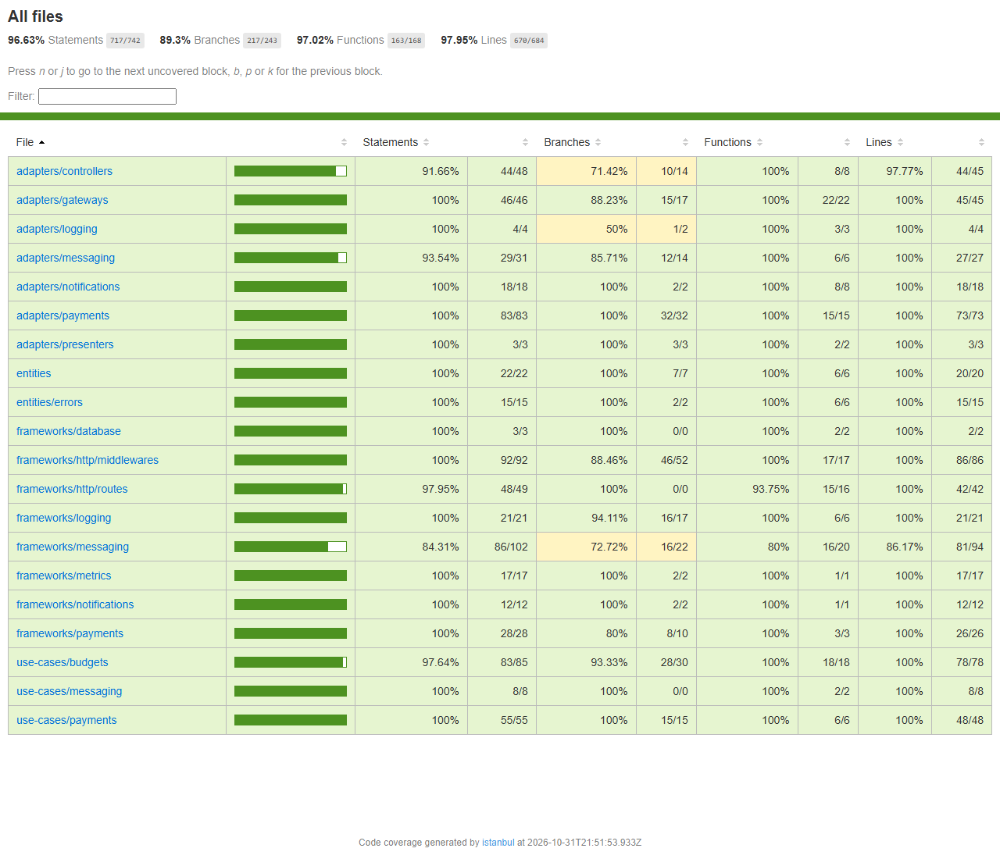

# Billing Service

Orçamento e pagamento das ordens de serviço da oficina. É um dos três microsserviços do Tech Challenge
da Fase 4, ao lado do OS Service e do Execution Service.

O serviço gera o orçamento de uma ordem a partir das linhas que o OS Service envia, registra a decisão
do cliente e cobra o orçamento aprovado pelo Mercado Pago. Ele conversa com os outros serviços só pelas
filas da saga; as rotas HTTP são as que o cliente, os funcionários e o provedor de pagamento chamam.

A arquitetura do serviço, com o diagrama, as mensagens que ele consome e produz e o modelo de dados, está
em [docs/architecture.md](docs/architecture.md). A arquitetura do sistema inteiro, com os ADRs da saga e
a RFC do Mercado Pago, fica no repositório do OS Service, em `docs/architecture/`.

## Papel na saga

A saga é orquestrada pelo OS Service. O Billing é o participante das etapas de orçamento e pagamento:

1. Recebe `GenerateBudget` com as linhas da ordem, cria o orçamento e responde `BudgetGenerated`.
2. O cliente aprova ou rejeita pelo `PATCH /service-orders/{id}/budget`, e o Billing responde
   `BudgetApproved` ou `BudgetRejected`.
3. Recebe `RequestPayment`, cria a cobrança no Mercado Pago e espera a notificação do pagamento.
4. Com a notificação, responde `PaymentConfirmed` ou `PaymentFailed`.
5. Numa compensação, recebe `CancelBudget` e responde `BudgetCancelled`.

Comandos chegam pela fila `billing-commands` e respostas saem pela `saga-replies`, as duas FIFO, com a
ordem como grupo de mensagens. As tabelas completas estão em [docs/architecture.md](docs/architecture.md#mensagens).

## Repositórios

| Repositório | Papel |
|---|---|
| [fiap-tech-challenge](https://github.com/diandria/fiap-tech-challenge) | OS Service e documentação central |
| fiap-tech-challenge-billing | Este serviço |
| [fiap-tech-challenge-execution](https://github.com/diandria/fiap-tech-challenge-execution) | Execution Service |
| [fiap-tech-challenge-infra-k8s](https://github.com/diandria/fiap-tech-challenge-infra-k8s) | Cluster, gateway, filas e observabilidade |
| [fiap-tech-challenge-infra-db](https://github.com/diandria/fiap-tech-challenge-infra-db) | Banco do OS Service |
| [fiap-tech-challenge-lambda](https://github.com/diandria/fiap-tech-challenge-lambda) | Funções de autenticação e notificação |

## Execução local

Pré-requisitos: Docker e Node.js 22.

```bash
cp .env.example .env
npm install
docker compose up -d
npm run db:migrate
```

Sobe `app` (porta 3001), `postgres` (porta 5433) e `localstack` (porta 4567). As portas são diferentes
das do OS Service, para os dois poderem rodar juntos.

| Rota | Para que serve |
|---|---|
| `GET /health` | Vivacidade; não consulta o banco |
| `GET /ready` | Prontidão; responde 503 se o banco não responde |
| `GET /metrics` | Métricas no formato do Prometheus |
| `GET /docs` | Swagger |
| `GET /service-orders/{id}/budget` | Orçamento da ordem, para o cliente dono ou para funcionários |
| `PATCH /service-orders/{id}/budget` | Aprovação ou rejeição do orçamento pelo cliente dono |
| `POST /payments/notifications` | Notificação de pagamento do Mercado Pago, aceita só com assinatura válida |
| `POST /payments/mock/{serviceOrderId}` | Pagamento simulado, só com `PAYMENT_PROVIDER=mock` e token de admin |

Quem pode chamar cada rota está em [docs/authorization-matrix.md](docs/authorization-matrix.md).

## Pagamento

O orçamento aprovado é cobrado pelo Checkout Pro do Mercado Pago. Quando o OS manda `RequestPayment`, o
Billing cria a preferência com o total do orçamento e guarda o link de pagamento, que o cliente vê em
`GET /service-orders/{id}/budget`.

| Variável | Para que serve |
|---|---|
| `MERCADO_PAGO_CLIENT_ID` e `MERCADO_PAGO_CLIENT_SECRET` | Credenciais da aplicação, trocadas por um token de curta duração (`client_credentials`) |
| `MERCADO_PAGO_NOTIFICATION_URL` | Endereço público de `POST /payments/notifications`, chamado pelo Mercado Pago |
| `MERCADO_PAGO_WEBHOOK_SECRET` | Segredo do webhook da aplicação, usado para conferir a assinatura de cada notificação |

Quando chega uma notificação assinada, o Billing consulta o pagamento na API e responde à saga com
`PaymentConfirmed` ou `PaymentFailed`. Pagamento aprovado com valor diferente do orçamento conta como
recusa (`AMOUNT_MISMATCH`).

Sem nenhuma delas o serviço sobe sem provedor de pagamento, e os pedidos de cobrança falham até um ser
configurado. Com só parte delas, o serviço não sobe.

### Pagamento simulado

Com `PAYMENT_PROVIDER=mock`, um provedor simulado substitui o Mercado Pago, e o `docker compose` local já
sobe assim. Só muda quem diz "pago" ou "recusado": orçamento, cobrança, confirmação, outbox e resposta à
saga são os mesmos de produção. O link de pagamento aponta para `POST /payments/mock/{serviceOrderId}`, que
um admin chama com `{ "status": "approved" }` ou `{ "status": "rejected" }`. Essa rota só existe no modo
simulado, e o webhook do Mercado Pago só existe no modo real; o serviço registra um aviso ao subir no modo
simulado.

`PAYMENT_PROVIDER` aceita `mercado-pago` ou `mock`; outro valor impede o serviço de subir. Sem a variável, o
serviço usa o Mercado Pago quando as variáveis dele estão definidas.

### Mercado Pago no ambiente de testes

1. Em **Suas integrações**, no Mercado Pago Developers, crie uma aplicação para Checkout Pro e copie o
   Client ID e o Client Secret dela, na tela **Credenciais**.
2. Na mesma aplicação, em **Webhooks > Configurar notificações**, preencha a **URL modo teste** com
   `<endereço do API Gateway>/payments/notifications`, marque o evento de pagamentos e clique em
   **Salvar**. A assinatura secreta gerada é o `MERCADO_PAGO_WEBHOOK_SECRET`. O endereço do gateway muda a
   cada recriação do ambiente, então essa URL precisa ser atualizada a cada sessão.
3. Em **Contas de teste**, crie uma conta de vendedor e uma de comprador, as duas do Brasil.
4. Cadastre os três valores no SSM com os comandos da seção [CI/CD](#cicd) e rode o CD de novo.
5. Para pagar, entre com a conta de teste de comprador, abra o link do orçamento e use um dos cartões de
   teste da documentação do Mercado Pago. Com o titular `APRO` o pagamento é aprovado; com `OTHE`, recusado.

Ainda falta confirmar no sandbox:

- Se a rota de token aceita `client_credentials` com as credenciais da aplicação. Se não aceitar, a RFC-006
  prevê voltar para o token da aplicação guardado como segredo.
- Qual link abre a compra de teste. O serviço guarda o `init_point` da preferência; a API também devolve um
  `sandbox_init_point`.
- Se a notificação enviada para a `notification_url` da preferência traz o cabeçalho `x-signature`. A
  documentação de webhooks descreve a assinatura só para a URL cadastrada no painel, e a URL da preferência
  tem prioridade sobre ela. Se a notificação chegar sem assinatura, o Billing responde 401 e o pagamento não
  é confirmado.

## Avisos ao cliente

Depois de gerar o orçamento, o Billing publica `BUDGET_READY`; depois de criar a cobrança, publica
`PAYMENT_REQUESTED` com o link de pagamento. Os dois vão para o tópico de notificações da Fase 3, no
contrato do ADR-003 estendido pelo ADR-015, e a função de notificações entrega ao cliente.

| Variável | Para que serve |
|---|---|
| `NOTIFICATION_CHANNEL` | `console` (padrão) só registra o aviso no log; `sns` publica no tópico |
| `SNS_TOPIC_ARN` | Tópico de notificações; obrigatório com `NOTIFICATION_CHANNEL=sns` |

O aviso é melhor esforço: sai depois do commit, e uma falha no envio fica no log e na métrica
`integration_failures_total`, sem desfazer o orçamento nem a cobrança.

## Kubernetes

Os manifestos ficam em `k8s/` e seguem os do OS Service, no namespace `car-repair-shop-billing`, que o
`infra-k8s` cria junto com o cluster.

| Recurso | Nome | Detalhe |
|---|---|---|
| ConfigMap | `billing-config` | Variáveis fixas, versionadas aqui |
| Service | `billing-api` | NLB interno; o API Gateway chega nele pela tag `service.k8s.aws/stack = car-repair-shop-billing/billing-api` |
| Deployment | `billing-api` | Probes em `/health` e `/ready`, rolling update de 25% |
| HPA | `billing-api` | De 2 a 4 réplicas por CPU, cabendo no cluster compartilhado com os outros serviços |
| PodDisruptionBudget | `billing-api` | Pelo menos uma réplica durante a drenagem de um node |
| Job | `billing-migrate` | `prisma migrate deploy` com a mesma imagem da aplicação |

O pipeline de deploy cria o ConfigMap `billing-runtime` (URLs das filas, tópico de notificações e endereço
público do webhook) e o Secret `billing-secret` (`DATABASE_URL`, `JWT_SECRET` e as credenciais do Mercado
Pago). O CI valida os manifestos com `kubeconform -strict`.

## Infraestrutura

O banco do Billing é provisionado por este repositório, na pasta `terraform/`, com estado próprio
(`billing/terraform.tfstate`, no mesmo bucket dos outros repositórios). Um `apply` aqui nunca toca o banco
do OS Service, e o contrário também vale. Filas, cluster e registro de imagens são plataforma
compartilhada e ficam no `infra-k8s`.

| Recurso | Detalhe |
|---|---|
| RDS PostgreSQL 16 `car-repair-shop-billing-db` | `db.t3.micro`, criptografado, sem acesso público |
| Security group | Porta 5432 aberta só para a faixa da VPC |
| Senha | Gerada pelo Terraform e guardada no SSM em `/car-repair-shop/billing/db/password` |

As pipelines de infraestrutura só rodam quando `terraform/` muda:

| Workflow | Quando | O que faz |
|---|---|---|
| `Infra CI` | Pull request | `fmt`, `validate`, `tflint`, `trivy` e a checagem de entrada pública; não precisa de credencial |
| `Infra CD` | Merge na `main` | `apply` e confirmação de que a instância está disponível e privada |
| `Infra destroy` | Manual, digitando `production` | `destroy` do ambiente |

O `Infra CD` e o `Infra destroy` usam os segredos `AWS_ACCESS_KEY_ID`, `AWS_SECRET_ACCESS_KEY` e
`AWS_SESSION_TOKEN` do repositório. As credenciais do Learner Lab expiram a cada sessão, então é preciso
atualizá-las antes de rodar.

Para validar localmente:

```bash
cd terraform
terraform fmt -check -recursive
terraform init -backend=false
terraform validate
tflint --init && tflint
python3 ../scripts/check-no-public-ingress.py
trivy config .
```

## CI/CD

O `CI` roda em todo pull request e em todo push na `main`: build, lint, testes, cobertura, validação dos
manifestos e a análise no [SonarQube Cloud](https://sonarcloud.io/project/overview?id=diandria_fiap-tech-challenge-billing), que reprova
o PR quando o quality gate reprova (`sonar.qualitygate.wait`) ou quando o segredo `SONAR_TOKEN` falta. O `CD` dispara quando o `CI` termina verde na `main` e publica o serviço no EKS, no namespace
`car-repair-shop-billing`:

1. Build da imagem e push no ECR `car-repair-shop-billing`, com a tag do SHA curto do commit.
2. Leitura da configuração na AWS. Se algum valor faltar, o deploy para aqui com `required value missing
   or empty: <nome>`, antes de aplicar qualquer coisa no cluster.
3. ConfigMap `billing-runtime` e Secret `billing-secret`, seguidos dos manifestos de `k8s/`.
4. Job `billing-migrate` com a imagem nova. Se a migration falha, nenhum pod novo sobe.
5. Troca da imagem do Deployment e espera do rollout; se ele não fica pronto em 5 minutos, o CD volta para
   a revisão anterior e termina com erro.
6. Verificação de `/ready` dentro de um pod, que confirma também o acesso ao banco.

De onde vem cada valor:

| Valor | Origem |
|---|---|
| Endereço, usuário e nome do banco | Instância `car-repair-shop-billing-db`, criada pelo `terraform/` deste repositório |
| Senha do banco | SSM `/car-repair-shop/billing/db/password`, escrita pelo mesmo Terraform |
| `JWT_SECRET` | SSM `/car-repair-shop/auth/jwt-secret`, escrito pelo Terraform das functions |
| Credenciais do Mercado Pago | SSM `/car-repair-shop/billing/mercado-pago-client-id`, `.../mercado-pago-client-secret` e `.../mercado-pago-webhook-secret`, cadastrados à mão |
| Filas `billing-commands` e `saga-replies` | `infra-k8s` |
| Tópico de avisos ao cliente | `car-repair-shop-service-order-events`, das functions |
| `MERCADO_PAGO_NOTIFICATION_URL` | Endereço do API Gateway mais `/payments/notifications` |

Os segredos são mascarados no log assim que lidos. Como no OS Service, os únicos segredos do GitHub são os
três da AWS; o resto vem do SSM, para não existir uma segunda cópia que possa divergir. Cada deploy fica
registrado em **Deployments → production**.

As credenciais do Mercado Pago não vêm do Terraform para nunca passarem por `tfvars` nem pelo estado.
Para cadastrá-las numa conta nova:

```bash
aws ssm put-parameter --type SecureString --name /car-repair-shop/billing/mercado-pago-client-id --value '<client id>'
aws ssm put-parameter --type SecureString --name /car-repair-shop/billing/mercado-pago-client-secret --value '<client secret>'
aws ssm put-parameter --type SecureString --name /car-repair-shop/billing/mercado-pago-webhook-secret --value '<assinatura secreta do webhook>'
```

## Testes

```bash
npm test                # unitários e de integração (o Testcontainers sobe Postgres e LocalStack)
npm run test:coverage   # com relatório de cobertura; o mínimo é 80%
```

Os testes de integração seguem o padrão GIVEN / WHEN / THEN.

### Cobertura

O mínimo de 80% vale para linhas, branches, funções e statements, e o `npm run test:coverage` falha abaixo
dele. O job `Coverage` do [CI](https://github.com/diandria/fiap-tech-challenge-billing/actions/workflows/ci.yml)
roda em todo PR e guarda o relatório HTML como artefato do run. O mesmo relatório alimenta a análise do
[SonarQube Cloud](https://sonarcloud.io/project/overview?id=diandria_fiap-tech-challenge-billing).

| Linhas | Statements | Funções | Branches |
|---|---|---|---|
| 97,95% | 96,63% | 97,02% | 89,3% |


