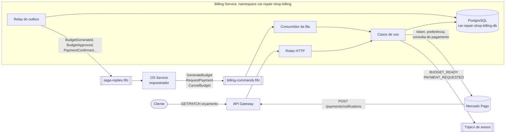

# Arquitetura do Billing Service

O Billing é dono do orçamento e do pagamento de cada ordem de serviço. Ele não decide quando uma ordem
avança: quem decide é o orquestrador da saga, no OS Service. O Billing executa os comandos que recebe,
guarda o resultado no próprio banco e responde à saga. As únicas entradas fora da saga são a decisão do
cliente sobre o orçamento e a notificação do Mercado Pago.

## Visão do serviço

Toda resposta à saga é gravada na tabela `outbox_messages` na mesma transação que muda o orçamento ou o
pagamento, e o relay publica depois. Assim não existe orçamento aprovado sem a resposta correspondente, nem
resposta para uma mudança que não foi gravada. Do lado do consumo, cada comando tratado fica em
`processed_messages`, e uma entrega repetida da fila não gera um segundo orçamento nem uma segunda cobrança.

## Camadas

O código segue a mesma Clean Architecture do OS Service, com as dependências apontando para dentro.

| Camada | Pasta | O que tem |
|---|---|---|
| Entidades | `src/entities/` | `Budget` e `Payment`, com as regras de transição de cada um |
| Casos de uso | `src/use-cases/` | Gerar, decidir e cancelar orçamento; cobrar e confirmar pagamento; publicar o outbox. As portas (`IPaymentGateway`, `IBudgetRepository`, `IOutbox`...) ficam em `ports/` |
| Adaptadores | `src/adapters/` | Controllers, repositórios Prisma, handler dos comandos, cliente do Mercado Pago, provedor simulado e notificador |
| Frameworks | `src/frameworks/` | Express, Prisma, SQS, OpenTelemetry, Prometheus e a montagem de tudo em `main.ts` |

O Mercado Pago aparece para os casos de uso só como `IPaymentGateway`. O provedor simulado implementa a
mesma porta, e é por isso que trocar um pelo outro não muda nada além de quem diz "pago".

## Mensagens

Comandos consumidos de `car-repair-shop-billing-commands.fifo`:

| Comando | O que o Billing faz | Resposta |
|---|---|---|
| `GenerateBudget` | Cria o orçamento com as linhas e o contato do cliente que vieram no comando, e avisa o cliente com `BUDGET_READY` | `BudgetGenerated` com `budgetId` e `total` |
| `RequestPayment` | Cria a preferência no Mercado Pago com o total do orçamento aprovado, guarda o link e avisa o cliente com `PAYMENT_REQUESTED` | Nenhuma na hora; a resposta vem com a notificação do pagamento |
| `CancelBudget` | Cancela o orçamento, se ainda existir algo a cancelar | `BudgetCancelled`, sempre, para a compensação nunca ficar esperando |

Respostas publicadas em `car-repair-shop-saga-replies.fifo`:

| Resposta | Origem |
|---|---|
| `BudgetGenerated` | Comando `GenerateBudget` |
| `BudgetApproved` e `BudgetRejected` | `PATCH /service-orders/{id}/budget`, chamado pelo cliente dono |
| `PaymentConfirmed` | Notificação do Mercado Pago de um pagamento aprovado com o valor do orçamento |
| `PaymentFailed` | Pagamento recusado ou aprovado com valor diferente (`AMOUNT_MISMATCH`) |
| `BudgetCancelled` | Comando `CancelBudget` |

Um comando que falha cinco vezes vai para a fila de descarte, e o OS trata isso como falha da etapa e
compensa. O caso mais comum é um `RequestPayment` que não consegue criar a preferência.

O envelope (`messageId`, `type`, `serviceOrderId`, `occurredAt`, `payload`) e as regras de ordenação e
deduplicação estão no ADR-015, no repositório do OS Service.

## Dados

Banco PostgreSQL próprio, que nenhum outro serviço acessa.

| Tabela | Conteúdo |
|---|---|
| `budgets` | Um orçamento por ordem, com o total, o status (`PENDING_APPROVAL`, `APPROVED`, `REJECTED`, `CANCELLED`) e uma cópia do nome e do e-mail do cliente |
| `budget_lines` | Linhas de serviço e de peça, com o preço da hora em que o orçamento foi gerado |
| `payments` | A cobrança do orçamento aprovado: preferência, link, valor cobrado, id do pagamento no Mercado Pago e status |
| `outbox_messages` | Respostas à saga esperando publicação |
| `processed_messages` | Comandos já tratados |

O nome e o e-mail do cliente são copiados do comando de propósito. Assim o Billing consegue avisar o cliente
sem consultar o OS, e continua funcionando com o OS fora do ar.

## Pagamento

O fluxo com o Mercado Pago, as alternativas descartadas e os riscos estão na RFC-006, no repositório do OS
Service. Em resumo:

1. O token de acesso vem de `POST /oauth/token` com `client_credentials` e é reaproveitado até perto de
   expirar.
2. `RequestPayment` cria uma preferência de Checkout Pro, com `external_reference` igual ao id da ordem, e
   o cliente paga fora da aplicação, pelo link.
3. O Mercado Pago chama `POST /payments/notifications`. A assinatura do cabeçalho `x-signature` é conferida
   antes de qualquer outra coisa; sem ela, a resposta é 401.
4. O Billing consulta o pagamento na API, em vez de confiar no corpo da notificação, e só então responde à
   saga.
